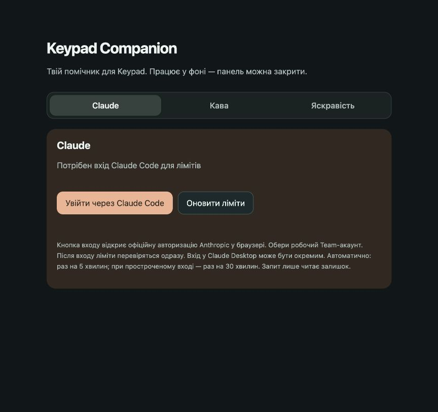

# Keypad Companion

A macOS helper for **Logitech MX Keypad**: automatic display brightness, configurable Caffeinate duration, and optional Claude weekly usage checks.

**The settings UI is in Ukrainian.** This README is in English so others looking for an MX Keypad brightness or AI workflow helper can find and use the project.

The helper starts when you log in and runs without a Dock or menu bar icon. Open its settings when you need them; closing the panel leaves the helper running.



## Open settings

Press **⌘Space**, search for **Keypad Companion**, and press Enter. You can also open the [local settings panel](http://127.0.0.1:57973/) on the Mac where the helper is installed.

Settings are split into three tabs: **Claude**, **Кава** (Coffee), and **Яскравість** (Brightness). The Ukrainian controls are explained below.

The Brightness tab shows the current Mac display and Keypad brightness, with three modes:

| UI label | Behavior |
| --- | --- |
| **Автоматично** — Automatic | Match Keypad brightness to the Mac display. |
| **Приглушити до 08:00** — Dim until 08:00 | Use the minimum brightness until the next 08:00, then resume automatic mode. |
| **Пауза** — Pause | Stop automatic adjustments and keep the current brightness. |

## Adjust brightness

Edit the **Твоя яскравість** (Your brightness) table to set your own curve. For example, set **Mac display 40% → Keypad 15%**, then click **Зберегти** (Save). Add or remove points as needed; the 0% and 100% display endpoints must remain.

Brightness is interpolated between points. The installation defaults are:

| Mac display | Keypad |
| --- | --- |
| 0% | 10% |
| 25% | 16% |
| 40% | 20% |
| 50% | 23% |
| 75% | 31% |
| 100% | 40% |

After a display brightness change, the helper waits for **3 seconds without another change**, then jumps directly to the new Keypad brightness. Moving the slider again restarts the wait. The display is checked once per second, so the usual response takes 3–4 seconds. The delay is configurable from 0 to 10 seconds.

Changing brightness manually in Logitech pauses synchronization for one hour. Click **Автоматично** (Automatic) to resume immediately.

## Caffeinate settings

The **Кава** (Coffee) card lets you set hours and minutes, then click **Зберегти час** (Save duration). The default is 2 hours; the supported range is 1 minute to 24 hours.

The saved duration applies the next time the companion Keypad button is turned on. Changing it does not alter an active countdown. The button shows the remaining time and progress relative to that session's duration.

## Claude weekly usage

The optional **Claude** tab shows the status of weekly usage checks. Click **Увійти через Claude Code** (Sign in through Claude Code) to open the official Anthropic browser sign-in using the installed `claude auth login --claudeai` command. Complete sign-in yourself and select your Team account; the helper then enables usage checks and checks immediately. This sign-in also changes the account used by Claude Code CLI. Claude Desktop may use a separate login.

The sign-in command does not start a model session. You can cancel an in-progress login in the panel. This is a wrapper around Claude Code's official sign-in, not an independent OAuth client. You can also sign in separately and click **Оновити ліміти** (Refresh limits). Otherwise, checks run every 5 minutes, or every 30 minutes when authorization is missing or expired. Temporary failures retry automatically after 1, 2, then 5 minutes. The last known allowance remains visibly stale for up to 30 minutes or until its reset time, whichever comes first; a confirmed authorization/access failure clears it.

Each usage check reads the current Claude Code authorization afresh. With checks enabled, an expiring access token is renewed automatically and the existing Keychain entry is updated. No model is invoked and no model credits are consumed. Interactive sign-in runs only after you click its button. Background Keychain reads and refresh writes run without authentication dialogs. If Keychain requires interaction, the panel shows it and retries silently every 30 minutes. Clicking Refresh limits (or completing an explicit sign-in/enabling checks) permits the macOS Keychain dialog for that request only; enter any password yourself in the system dialog. Access-control rules are not changed by the helper. The `/usr/bin/security` credential reader is no longer spawned. OAuth URLs, tokens and command output are not exposed in the panel or logs.

This integration currently requires a **Claude Code Team account** and is disabled by default. A successful sign-in from the panel enables it. To enable it with an existing login instead, create the following private file outside the repository:

`~/Library/Application Support/KeypadBrightness/ai-settings.json`

```json
{"claudeEnabled": true}
```

Use **Вимкнути перевірки** (Disable checks) to stop credential reads and remove cached usage; Claude Code stays signed in. The same button enables checks again using the existing credential. Access tokens renew automatically when a usable refresh token is present. If refresh is revoked or unavailable, use the official sign-in button. Simply launching the CLI is not guaranteed to renew credentials. HTTP 401, HTTP 403, and local expiry are reported separately.

The usage endpoint is internal to Anthropic and may change. Other subscription plans are not supported by the current implementation. Missing or expired authorization is reported as a status, not as a fabricated quota.

**Keypad button integration:** the companion Logitech plugin source is included in [`plugin/`](plugin/README.md). It adds fixed GPT, Claude, Caffeinate, and capture buttons, with contextual controls for PrusaSlicer, Xcode, browsers, Slack, Google Meet, and Zoom. The background helper supplies brightness, duration settings, and sanitized Claude usage. Installing the helper alone does not assign the Keypad buttons; see the plugin build and installation instructions.

## Install

Requirements: macOS, a connected MX Keypad, running **Logi Options+** background components, **Node.js 20+**, Python 3, and Xcode Command Line Tools with the Swift compiler.

From the repository directory, run:

```sh
python3 install.py
```

The installer builds the app and configures automatic startup for the current user. Running it again updates the app while preserving your saved brightness curve. It also migrates an installation under either previous Ukrainian app name.

| Item | Location |
| --- | --- |
| App | `~/Applications/Keypad Companion.app` |
| Settings and runtime data | `~/Library/Application Support/KeypadBrightness` |
| Startup definition | `~/Library/LaunchAgents/local.keypad-brightness.plist` |

The internal data directory and startup identifier retain their original names for compatibility. You can keep the source anywhere, including iCloud Drive: the installed app runs independently of the repository. Node.js runs the helper in the background; you do not need to open it separately.

## Privacy

Brightness synchronization reads the Mac display brightness and Logitech backlight setting. It does not read keystrokes or passwords.

If explicitly enabled, Claude usage checks read the existing **Claude Code** credential from macOS Keychain and send it only to Anthropic for `GET https://api.anthropic.com/api/oauth/usage`. The credential is not written to files or logs and is not passed to the Logitech plugin. Checks do not invoke a model, purchase credits, or refresh authorization.

Usage checking shares the existing brightness helper. A short-lived child process reads authorization and performs the request, then exits. There is no additional persistent service, startup job, or icon.

Private runtime files contain settings, sanitized numeric usage, quota reset and update times, and check status. They live outside the repository. `.gitignore` additionally excludes runtime data, authorization files, and common secret files. Do not copy credentials or private runtime data into the source directory.

The settings server listens only on `127.0.0.1`. Requests that change settings require the expected origin and a random per-process token. That token is local panel protection, not a saved API credential.

## Limitations

- Reads the main display brightness. Tested on a MacBook Pro's built-in display; external displays have not been verified.
- Waits for reconnection when the display is asleep or Logitech is unavailable.
- Uses Logitech's internal local interface and macOS DisplayServices. Logitech or macOS updates may require changes.
- This is an independent project, not an official Logitech application.

## Uninstall

```sh
python3 uninstall.py
```

Removes the app and startup job. The Keypad keeps its current brightness. Saved settings remain available for a later reinstall.

## Development

Run the tests with:

```sh
node --test test/*.test.mjs
python3 -m unittest discover -s test -p '*_test.py'
```

`helper.mjs` coordinates brightness and the settings panel. `brightness.mjs` validates and interpolates the curve; `logi-client.mjs` talks to Logitech; `display-brightness.py` reads the display brightness. For compatibility with early Companion sign-ins that omitted `USER`, the usage reader considers the current macOS account and the legacy `unknown` account under the exact `Claude Code-credentials` service, selecting the valid Team token with the latest expiry. New sign-ins explicitly pass the macOS username.

The plugin reads private `caffeine-settings.json` (`durationMinutes`, integer minutes) and `claude-quota.json` (`remaining`, integer percentage; `resetsAt`, Unix seconds; `updatedAt`, ISO UTC). Both live in `~/Library/Application Support/KeypadBrightness`; quota is removed after a confirmed authorization/access failure or disabling checks. Temporary failures mark the last value with `stale: true`; it remains visibly stale for up to 30 minutes or until reset, whichever comes first. A successful check replaces it with fresh data. No credential is included.

The Claude modules delegate official sign-in and check and sanitize usage, and `caffeine.mjs` validates the saved duration.

`lib/ws` includes the WebSocket library `ws` and its license. The repository contains source code and installation defaults; current runtime state and logs are excluded from Git.

## Logitech service monitoring

The existing helper samples the verified, current-user Logitech Plugin Service every **two hours**. Each check measures CPU over three seconds, rather than averaging away a short spike across two hours. RSS memory appears during the first sample; 100% CPU means one core. The collector uses native macOS process APIs, not `ps`. Failed checks retain explicitly stale readings with their timestamps.

Automatic recovery is enabled by default and can be disabled in the Logitech tab. It first becomes eligible after two hours. CPU of at least **50%** or RSS of at least **1024 MiB** triggers a confirmation check after **30 seconds**; the same threshold must still be exceeded by the same process. Fresh, nonce-bound safety responses from the running plugin are required before confirmation and directly before termination. Active calls, screen recordings, active input/output audio (including music), unreadable UI, stale replies, changed processes or missing permission block the automatic restart. Background Safari/Firefox tabs and Slack/Zoom windows are included; unsupported call/capture clients conservatively defer recovery. No window is activated, meeting joined or media permission requested.

Before automatic recovery, a two-second native stack sample replaces the previous private diagnostic in `~/Library/Application Support/KeypadBrightness/Diagnostics`. Failed diagnostics prevent recovery. Only the exact verified Logitech process receives SIGTERM; a stuck process is never force-killed. Profiles remain intact. Recovery attempts are persisted: if high load returns after one automatic attempt, further automatic restarts stop until a subsequent healthy check. There is no restart loop, extra service or Dock icon.

The authenticated manual **Restart service** button remains available, including during an automatically deferred check. It is a deliberate user action and does not use the automatic safety gate. Concurrent requests and rapid repeat clicks are blocked. The latest 24 hours of sanitized check times, CPU, RSS and health states stay in the private `logitech-health.json`; diagnostics, request/reply files and recovery state never belong in Git.

## Verified Google Meet navigation

The browser button opens a new tab in the current window and sets the entire fixed `https://meet.google.com/` address through macOS Accessibility. Navigation proceeds only after exact address readback and focus/window verification. The plugin never types URL characters through Logitech's keyboard API. Unsupported address fields fail closed. Meet page actions require the loaded document to remain on the exact HTTPS `meet.google.com` origin. The clipboard receives only a validated meeting-code URL. Google sign-in and camera/microphone permission prompts remain user actions.

Browser automation can stop if you change the active window during the operation. Safari uses native address-field confirmation and has been physically confirmed in both Work and Personal profiles. Firefox uses a process-targeted Return after exact address and focus checks and has also been physically confirmed: its button creates an instant meeting and copies the validated link. Firefox containers and Chrome have not been physically verified.

## Automatic Claude login renewal

When usage checks are enabled, the helper renews an expiring access token within five minutes of expiry, or once after a usage HTTP 401. It sends the existing refresh token only to the fixed official Anthropic OAuth endpoint, using the original scopes and public Claude Code client ID. This makes no model requests and incurs no inference usage.

Rotated tokens update only the existing Claude Code entry in macOS Keychain, never files, logs or the repository. The helper respects both current and legacy Claude Code refresh locks, maintains a heartbeat and checks that the login has not changed before saving. Disabling usage checks also stops automatic renewal. Transient failures retry in five minutes; contention retries in one minute. A revoked refresh token requires signing in again. This integration depends on an internal provider protocol and may need updates when Claude Code changes.

## Event-driven Keypad updates

The plugin uses macOS workspace/window notifications and local file notifications, with a one-minute recovery check for contextual layout, call states, recording detection and PrusaSlicer. Actions validate fresh state before execution. If an application does not send a supported Accessibility notification, direct UI changes can take up to one minute to appear. The recording counter advances locally; Caffeinate refreshes only at displayed minute/progress boundaries or process exit. See [plugin scheduling](plugin/README.md#update-scheduling) for the remaining in-memory Claude registry checks.

Mac screen brightness is still sampled once per second. Idle Logitech device-setting reads are cached for one minute; screen brightness changes, explicit actions and writes force fresh verification. This adds no service or permission and does not change the brightness mapping or configured settle delay.
